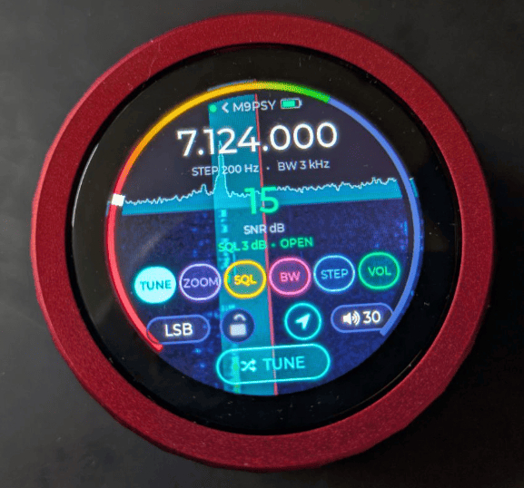
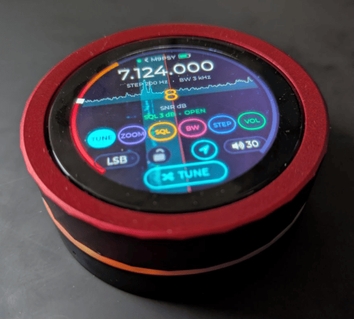

# UberSDR Dial

ESP32 firmware that turns the **Guition JC3636K518C** (also sold as
JC3636K718) into a hand-held front end for [UberSDR](https://ubersdr.org).
The board is ESP32-S3 based: a 1.8" round touch display on a rotary knob.

Tested with the **JC3636K718C-I-Y1(RD)**
([AliExpress](https://www.aliexpress.com/item/1005011771382178.html)).

<p align="center">
  
  
</p>

## Install

### From your browser (easiest)

**[Open the web flasher](https://madpsy.github.io/ubersdr_dial/flash/)** in
Chrome or Edge, plug the dial in over USB-C, and click **Connect**. You don't
need drivers or a toolchain, and usually not the BOOT button either.

You can also enter your Wi-Fi details first. The page adds them to the flash
image right there in your browser, so they're never sent anywhere. On first
boot the dial joins your network straight away. If you leave them blank, the
dial starts its setup hotspot instead (see below).

Normally the flasher resets the dial into download mode by itself. If no port
shows up or flashing fails to start, put it into download mode by hand. This
is needed if the firmware on the dial has crashed or never finished flashing:

1. Switch the dial off.
2. Push a pin into the small hole next to the USB-C port and keep it held
   down. That's the BOOT button.
3. Switch the dial on with the pin still held, then let go.

The screen stays dark. Flash it, then switch it off and on again.

How it works: the settings go into a dedicated `usercfg` flash partition. The
firmware imports them on first boot, then erases that partition.

### From source

See [Building](#building).

## Features

Each time it starts, the dial asks which mode to use. Your last choice is
already highlighted.

- **Receiver (Wi-Fi):** the dial is the radio. Pick an UberSDR receiver from
  the list, and it streams audio to its own speaker while showing the
  spectrum and waterfall. Receivers on your own network are found over mDNS
  and listed first, above the public ones.
- **Controller:** the dial is a remote knob for the UberSDR v2 web UI. In SDR
  Control → Dial, connect over **Bluetooth** (Web Bluetooth) or **USB**
  (Web Serial, over the USB-C cable). Pick the same one on the dial's start
  screen. The dial then shows the page's frequency, signal and waterfall. USB
  needs no pairing and charges the dial while you use it. Both work in Chrome
  or Edge and in the UberSDR desktop app. The protocol is in
  [docs/PROTOCOL.md](docs/PROTOCOL.md).

Both modes share the same screen:

- **Knob:** turns whatever page is selected: tune, volume, zoom, squelch,
  bandwidth or step size. Turning faster while tuning makes bigger steps.
- **Page buttons:** jump straight to a page.
- **Chip at the bottom:** tap for the next page, hold for the menu.
- **Waterfall:** drag to pan, tap to tune.
- **SNR ring:** shows signal strength around the edge. Drag the squelch notch
  along it to set squelch.
- **Frequency:** tap to open the band picker.
- **Mode button:** tap to step through modes, hold for the mode picker.
- **Volume button:** tap to mute.
- **Padlock:** locks tuning.
- **Header:** in Receiver mode, tap it to pick another receiver.
- **LED ring and haptics:** give feedback while you turn and tap.

Settings are kept across power cycles: Wi-Fi, the chosen receiver, the last
frequency, mode and view, and the menu options.

### First-time Wi-Fi setup

With no Wi-Fi configured, the dial starts a hotspot called
`UberSDR-Dial-XXXX`. Join it from a phone. A setup page opens; if it doesn't,
browse to `http://192.168.4.1/`. Choose your network and enter its password.
To change networks later, use **Wi-Fi setup** in the menu.

## Hardware

Guition JC3636K518C (also sold as JC3636K718):

- ESP32-S3R8, with 16 MB flash and 8 MB octal PSRAM
- 360×360 ST77916 display over QSPI, with CST816 touch
- Rotary encoder
- PCM5100A DAC and speaker
- WS2812 LED ring
- Haptic motor
- Battery

## Building

The firmware builds with [PlatformIO](https://platformio.org): the CLI or the
VS Code extension. The libraries are fetched automatically on the first build:
LVGL 9.2, NimBLE, WebSockets, ArduinoJson, ESP8266Audio (Opus) and
Adafruit NeoPixel.

```sh
pio run -e jc3636k718                 # build
pio run -e jc3636k718 -t upload       # build and flash over USB-C
```

The board uses the ESP32-S3's native USB, so esptool normally resets it into
download mode by itself. If it can't, use the manual BOOT-button method in
[Install](#from-your-browser-easiest). On Linux it appears as
`/dev/ttyACM0`.

To read the serial log, use `pio device monitor`. You can also open the port
yourself, but keep echo off. On Linux:

```sh
stty -F /dev/ttyACM0 -hupcl raw -echo 115200 && cat /dev/ttyACM0
```

`jc3636k718` is the environment to use. `jc3636k718-idf`, which builds Arduino
as an ESP-IDF component, is an experiment and isn't recommended.

### Releasing

```sh
./release.sh 1.2.0
```

This does the whole release:

1. Checks that you're on a clean `main` that's level with GitHub.
2. Writes the version into `VERSION` and the flasher's manifest and page.
3. Builds the firmware and copies `bootloader.bin`, `partitions.bin`,
   `boot_app0.bin` and `firmware.bin` into `docs/flash/`.
4. Checks that those binaries are this build.
5. Commits, tags `v1.2.0` and pushes.

GitHub Pages then publishes the new flasher from the `docs/` folder. The
firmware gets its version from `VERSION` at build time and shows it on the
start screen.

To stage the binaries without releasing, run `./build.sh` on its own. The page itself is
`docs/flash/index.html`, using
[ESP Web Tools](https://esphome.github.io/esp-web-tools/) (Apache 2.0).

### Layout

| Path | Contents |
| --- | --- |
| `src/hw/` | Board drivers: display and layered compositor, touch, encoder, LEDs, haptics, battery |
| `src/app/` | Receiver engine (`local_radio`), UberSDR spectrum and audio sockets (`sdr`, `audio`), the controller link to v2 (`ctrl_link`) over Bluetooth (`ble_ctrl`) or USB (`usb_ctrl`), settings, Wi-Fi setup |
| `src/ui/` | LVGL screens: the dial screen used by both modes (`screen_controller.cpp`), receiver picker, menus, fonts |
| `include/lv_conf.h` | LVGL configuration |
| `partitions_dial.csv` | Flash layout: the 16 MB default plus a `usercfg` slot for the web flasher |
| `docs/flash/` | Browser flasher (GitHub Pages) |
| `docs/PROTOCOL.md` | Controller protocol: the records, and how Bluetooth and USB carry them |
